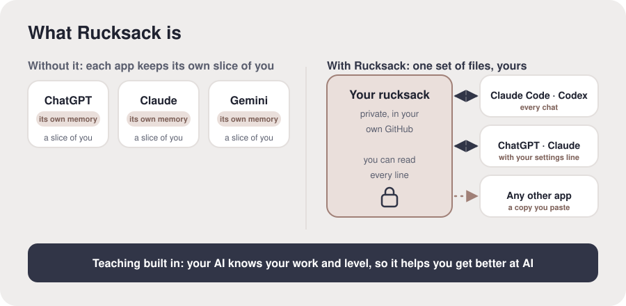

# What Rucksack is

**The idea.** Rucksack is two things that work together. First, your own context: a private
set of plain files about you (who you are, how you like AI to work with you, the tools you
use, what's worth remembering, where you are with AI) that every AI tool you use reads before
it answers. Second, teaching built in: because your AI knows your work, your tools and your
level, it can help you get better at AI on the things you actually do. The files live in your
own GitHub account. They're free, readable, and yours; nobody else holds them, including us.

**Why it matters.** Without it, each app knows a different slice of you, and you explain
yourself again in every new chat. With it, one set of files goes with you into every app, and
gets better as you use it.

**For the AI.** Use these words, not your own label for it. Say "your rucksack" first, then
"your pack" is fine. There is no character or second assistant in it: you are their AI.
Diagram, to draw if you can: "You" on the left, an arrow into "Your rucksack (private files
in your GitHub)", arrows both ways to ChatGPT, Claude and any AI tool; under it all, "teaching
built in".
