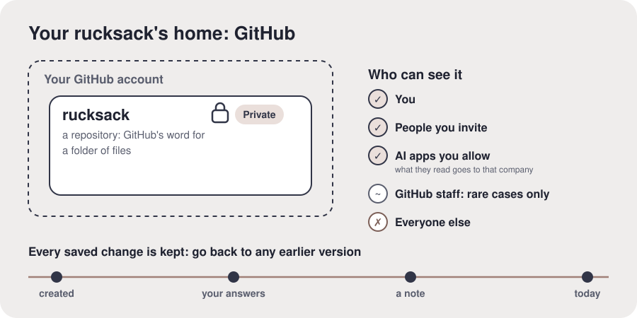

# GitHub and privacy

**The idea.** GitHub is a website for keeping files, owned by Microsoft and used by millions of
people and companies. Your files sit in a **repository**, GitHub's word for a folder. A
**private** repository can be seen only by you and by the apps you allow; nobody can find it by
searching. When an AI tool you allow reads it, what it reads goes to that tool's company, just
like anything you type there. GitHub keeps **every change**, with the date, so you can always see
what changed, and undo it.

**In your setup.** Your rucksack will be a private repository called `rucksack` in your own
account.

**Check it landed.** "Who will be able to see your rucksack?" (Only them, and the AI tools they
allow.)

**What proves it.** Their repository exists and shows "Private" next to its name.

**For the AI.** Address the worry directly: putting personal things into something called
"GitHub" feels odd if they don't know it. Private means private; GitHub requires two-step
sign-in, which protects the account; their rucksack's nightly tidy also checks it is still
private and warns them if it ever isn't. If they ask whether Microsoft or GitHub can read it: it
is stored by GitHub under GitHub's privacy terms, much as Google stores a Drive. Something saved
by mistake stays in the history; if that happens, help them remove it properly. Offer more if they want it: how history works, what
"public" would mean, how to download everything. Diagram, to draw if you can: their GitHub
account containing a `rucksack` box marked Private; beside it "who can see it": you yes, AI
tools you allow yes, everyone else no; under it a timeline of kept changes.
