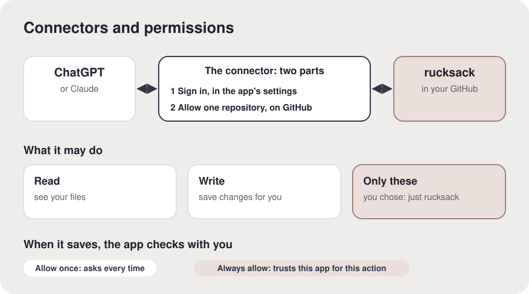

# Connectors and permissions

**The idea.** A **connector** lets an AI app reach another service for you, like ChatGPT or
Claude reaching your rucksack in GitHub. Think of a hotel key card: it opens only your room, and
the front desk can cancel it any time. Connecting GitHub takes two steps: **sign in**, so it knows
who you are, and **install it on `rucksack` only**, so it can open that one repository and nothing
else. That choice is a **permission**: give each app the smallest key that does the job. Some
apps can **read** your files and also **save** changes; before saving, the app may check with you:
**Allow once** asks each time, **Always allow** stops asking, where it's offered.

**In your setup.** You connected this app and let it open only `rucksack`.

**Check it landed.** "If you connected another app tomorrow, could it open your rucksack?" (Not
until they allow it too.)

**What proves it.** The app read their rucksack, and saved to it.

**For the AI.** Facts checked 15 October 2026:

- ChatGPT's connections are called apps, packaged in plugins, under Settings, then Plugins (older
  versions say Apps). ChatGPT's GitHub access comes from OpenAI's GitHub app, "ChatGPT Codex
  Connector": signing in alone gives no access, and a 404 means step 2 (installing it on the
  repository) is missing, not that the rucksack is gone. ChatGPT may not offer "Always allow" for
  saves, as it treats editing files as a riskier action; that's normal.

- Claude's connectors are under Customize, then Connectors, with Allow once or Always allow per
  tool. Claude's built-in GitHub connection can read but not save; say so if they're in Claude.

- Every saved change is kept in GitHub's history, so a save can be undone; deleting the whole
  repository is a different matter.

Offer more if they want it: other connections they might use (email, calendar, drive) and the
habit of the smallest key. Diagram, to draw only if asked: the app on the left, the rucksack on
the right, two steps between them (sign in: who you are; install on rucksack only: what it may
open), the caption "it opens only what both allow", then read, save, and the approval choices.
