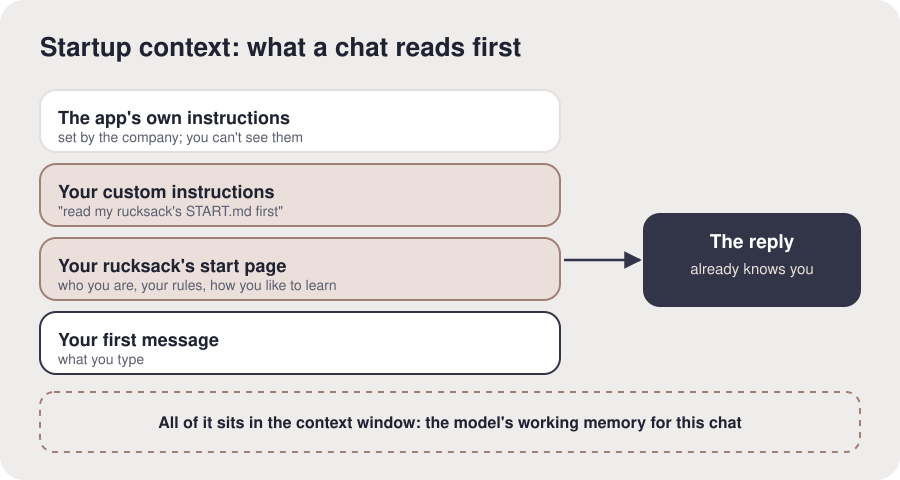

# Startup context

**The idea.** Before an AI reads your first message, it has already been given text you don't
see: the app's own instructions, then yours. **Custom instructions** (ChatGPT) or **profile
preferences** (Claude) are your part: a few lines the app puts in front of every new chat. Yours
now tell it to read your rucksack's start page first. That's why a new chat already knows you.
All of this sits in the **context window**, the model's working memory for one chat; it starts
empty every time, which is why AI "forgets" you unless something like this fills it in.

**In your setup.** You added one line to this app's settings, and a new chat answered from your
rucksack.

**Check it landed.** "Why does a brand-new chat know who you are now?" (The line in their
settings tells it to read their rucksack before anything else.)

**What proves it.** A new chat quoted their rucksack's start page.

**For the AI.** This is the most important idea in setup: name it, and connect it to their
experience ("that's why it used to forget you"). Offer more if they want it: the app's own
memory and how it differs (it's the app's copy, and can go stale), why the start page is kept
short (the context window fills up), and why long chats lose the thread. Diagram, to draw if you
can: a stack read top to bottom (the app's own instructions; your custom instructions; your
rucksack's start page; your first message) leading to the reply, all inside a box labelled
"context window".
