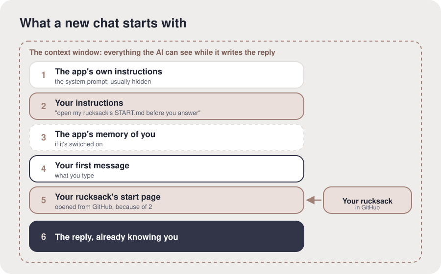

# What a new chat starts with

**The idea.** An AI model remembers nothing between chats; each one starts fresh, like the film
*50 First Dates*. So before your first message, the app puts things in front of it: its own
instructions (the **system prompt**), then **your instructions**, the few lines you set in its
settings, and, if it's on, the app's own memory of you. Your line tells it to open your
rucksack's start page before it answers, so it reads that too. All of it, your message and its
reply included, sits in the **context window**: everything the AI can see while it writes this
reply, its working memory.

**In your setup.** You added one line to this app's settings, and a new chat answered from your
rucksack.

**Check it landed.** "Why does a brand-new chat know who you are now?" (The line in their settings
tells it to open their rucksack before it answers.)

**What proves it.** A new chat quoted their rucksack's start page.

**For the AI.** Facts checked 15 October 2026: ChatGPT's field is Custom instructions (Settings,
Personalization); Claude's is Instructions for Claude (Settings, General). Both apps also keep
their own memory, which carries into new chats: that's kept by one app and chosen by the app;
their rucksack is theirs, readable, and works in any app. ChatGPT shows a Sources link listing
what it used; Claude shows when it searches past chats. A truly fresh chat is ChatGPT's Temporary
Chat or Claude's Incognito. The start page is kept short because the context window is finite and
gets worse as it fills ("context rot"). The film analogy is Andrej Karpathy's. Diagram, to draw
only if asked: a box labelled "context window" holding, in order: the app's instructions (usually
hidden; Anthropic publishes Claude's), your instructions, the app's memory if on (dashed), your
message, your rucksack's start page (arriving from GitHub), and the reply.
