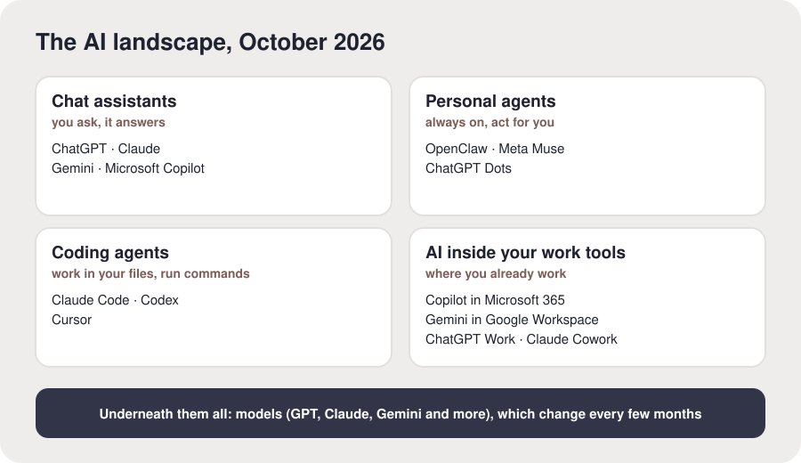

# The AI landscape

**The idea.** Most AI tools are one of four kinds, and one company often makes several.
- **Chat assistants:** you ask, it answers. ChatGPT, Claude, Gemini, Microsoft Copilot.
- **Personal agents:** always on, acting for you across your apps. OpenClaw, Meta Muse,
  ChatGPT Dots.
- **Coding agents:** they work in your files and run commands, more and more for everyday work,
  not just code. Claude Code, Codex, Cursor.
- **AI inside your work tools:** where you already work. Copilot in Microsoft 365, Gemini in
  Google Workspace, ChatGPT Work, Claude Cowork.

Underneath them all are **models**, the part that thinks (OpenAI's GPT, Anthropic's Claude,
Google's Gemini). They change every few months, which is why your rucksack keeps your context
outside any one of them.

**In your setup.** You listed the AI tools you use, and what you use each for.

**Check it landed.** "Which kind is the tool you use most, and which kind haven't you tried?"

**What proves it.** Their tools are listed in their rucksack, by kind and use.

**For the AI.** These examples were checked on 15 October 2026 against Rucksack's own research;
the field moves monthly, so mention anything newer you know, and say so. "Copilot" is three
products: the Microsoft Copilot app, Copilot in Microsoft 365 apps, and GitHub Copilot for code. Relate it to them: which kinds they use, which they
don't, and one they might try for something they told you they do. Offer more if they want it:
how to choose between them, free versus paid, and local models that run on your own computer.
Diagram, to draw if you can: four boxes (chat assistants, personal agents, coding agents, AI
inside work tools) with their examples, and a bar under them all labelled "models".
